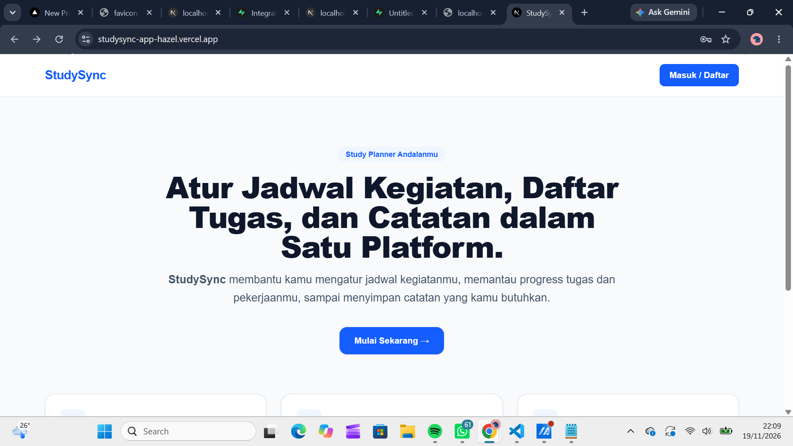
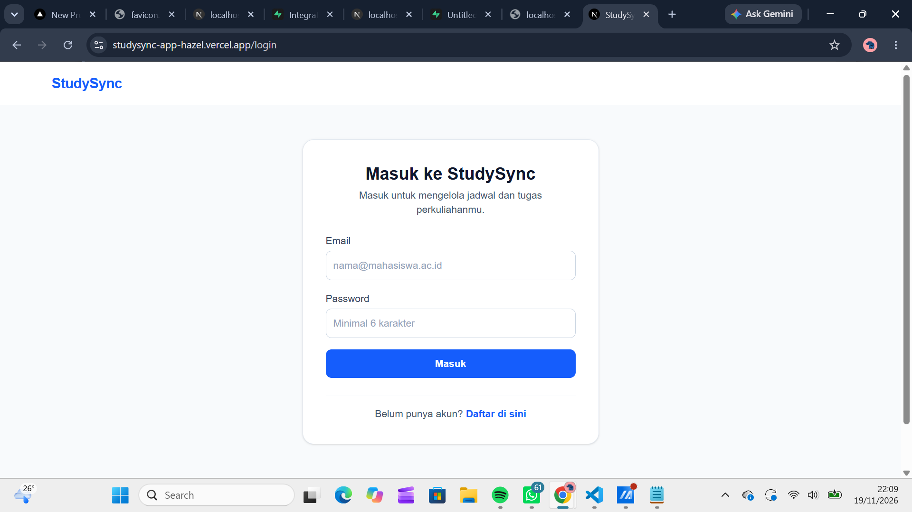
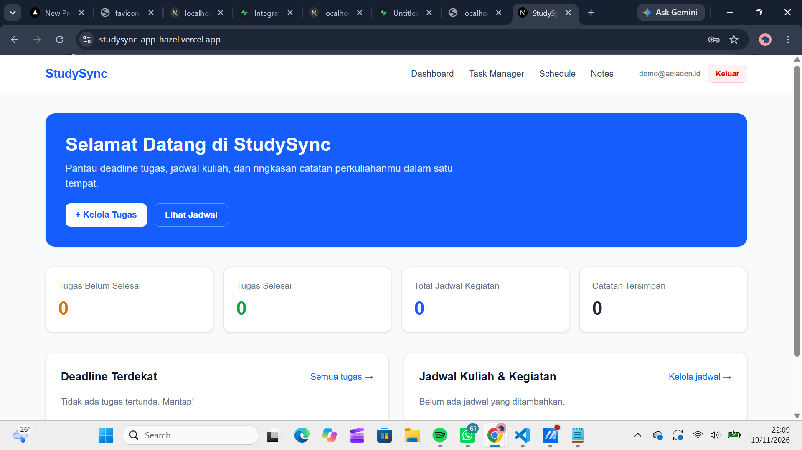
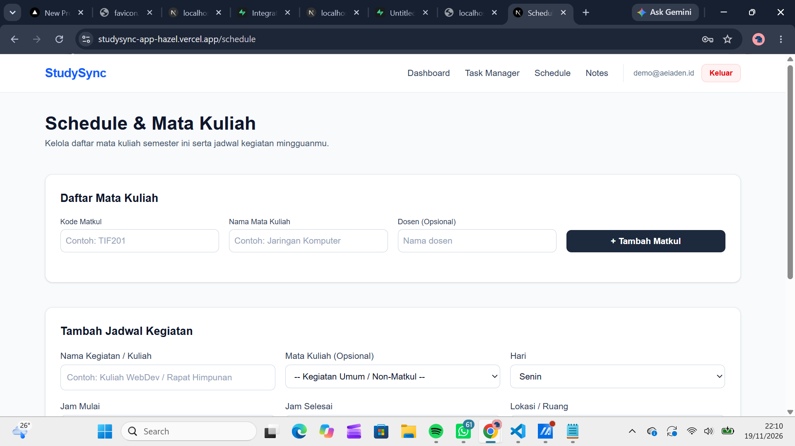
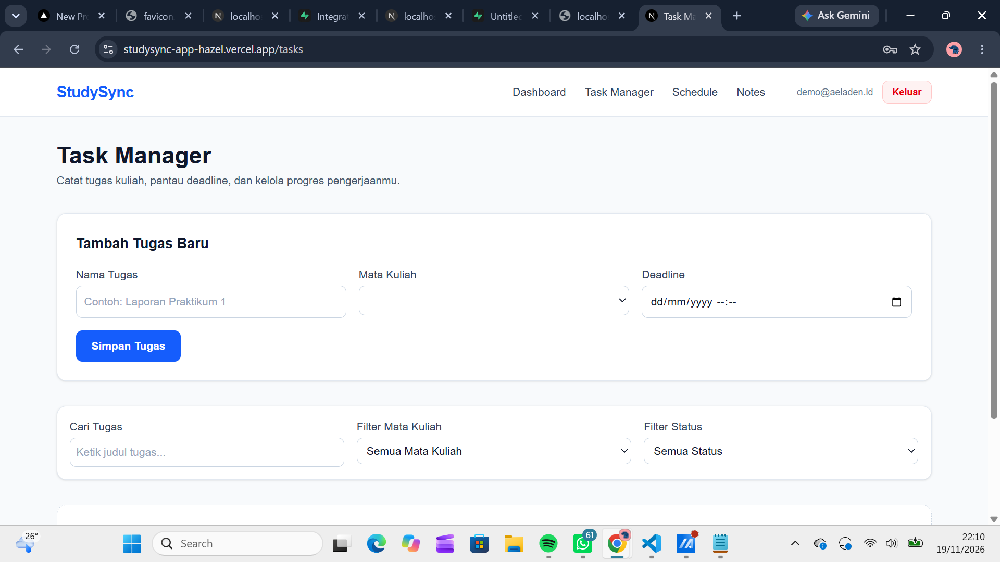
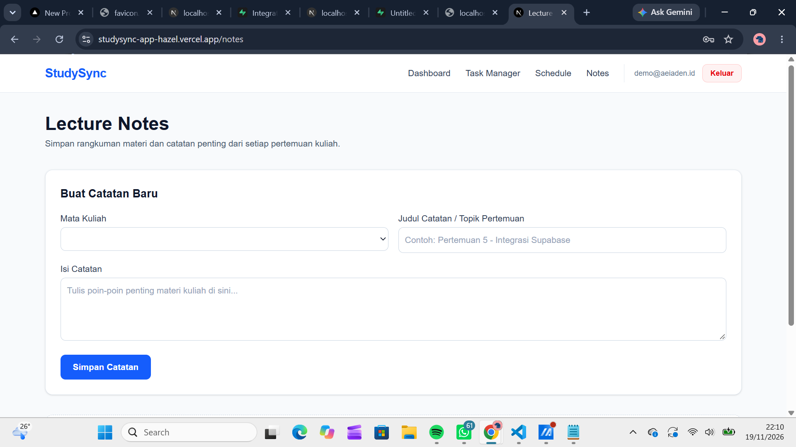

# StudySync — Study Planner Andalanmu

**StudySync** adalah aplikasi web perencana akademik dan produktivitas harian berbasis pengguna (*user-based*) yang membantu mengatur jadwal kegiatan, daftar tugas beserta deadlinenya, serta catatan dalam satu platform yang terintegrasi secara *real-time*.

🔗 **Live Demo:** [https://studysync-app-hazel.vercel.app](https://studysync-app-hazel.vercel.app)

---

## 📸 Preview Aplikasi

| Halaman Intro (Landing Page) | Halaman Login & Register |
| :---: | :---: |
|  |  |

| Dashboard Utama | Task Manager & Deadline |
| :---: | :---: |
|  |  |

| Schedule & Mata Kuliah | Personal Notes |
| :---: | :---: |
|  |  |

---

## ✨ Fitur Utama

- **Landing Page & Autentikasi Pengguna (Login / Register):** Pengunjung disambut dengan halaman pengenalan fitur sebelum masuk menggunakan akun pribadi melalui Supabase Auth.
- **Isolasi Data Pribadi (Row Level Security):** Setiap pengguna memiliki ruang kerja terpisah sehingga jadwal, tugas, mata kuliah, dan catatan tidak bercampur dengan pengguna lain.
- **Dashboard Ringkasan:** Menampilkan statistik tugas yang belum selesai, tugas selesai, total jadwal kegiatan, catatan tersimpan, serta pratinjau tenggat waktu terdekat.
- **Task Manager & Deadline:** Mencatat seluruh tugas kuliah maupun pekerjaan beserta mata kuliah terkait, tenggat waktu (*deadline*), filter pencarian, dan pembaruan status progres pengerjaan.
- **Schedule & Mata Kuliah (CRUD):** Mengelola daftar mata kuliah (tambah, edit, hapus beserta dosen pengampu) serta menyusun jadwal harian dari jadwal kuliah hingga kegiatan di luar kelas.
- **Personal Notes:** Menyimpan dan mengorganisir catatan ringkasan materi berdasarkan kategori mata kuliah dengan mudah.

---

## 🛠️ Teknologi yang Digunakan

- **Frontend:** Next.js (App Router), React, TypeScript, Tailwind CSS
- **Backend & Database:** Supabase (PostgreSQL, Authentication, Row Level Security / RLS)
- **Deployment:** Vercel

---

## 🚀 Cara Menjalankan Secara Lokal

1. **Clone repository ini:**
   ```bash
   git clone [https://github.com/aeiaden/studysync.app.git](https://github.com/aeiaden/studysync.app.git)
   cd studysync.app
   ```

2. **Install dependensi:**
   ```bash
   npm install
   # (Atau gunakan npm.cmd install jika memakai PowerShell Windows)
   ```

3. **Konfigurasi Environment Variables:**
   Buat file `.env.local` di direktori utama proyek, lalu isi dengan kredensial proyek Supabase kamu:
   ```env
   NEXT_PUBLIC_SUPABASE_URL=https://[GANTI_DENGAN_ID_PROYEK_SUPABASE_KAMU].supabase.co
   NEXT_PUBLIC_SUPABASE_PUBLISHABLE_KEY=[GANTI_DENGAN_ANON_KEY_SUPABASE_KAMU]
   ```

4. **Jalankan server pengembangan:**
   ```bash
   npm run dev
   # (Atau gunakan npm.cmd run dev jika memakai PowerShell Windows)
   ```
   Buka `http://localhost:3000` di browser.

---

## 👤 Pembuat

- **Nama:** ADENIA AZZAHRA
- **NIM - Prodi:** 26/577476/TK/65676 - Teknologi Informasi
- **GitHub:** [aeiaden](https://github.com/aeiaden)
- **Keterangan:** Final Project Web Development I (2026)